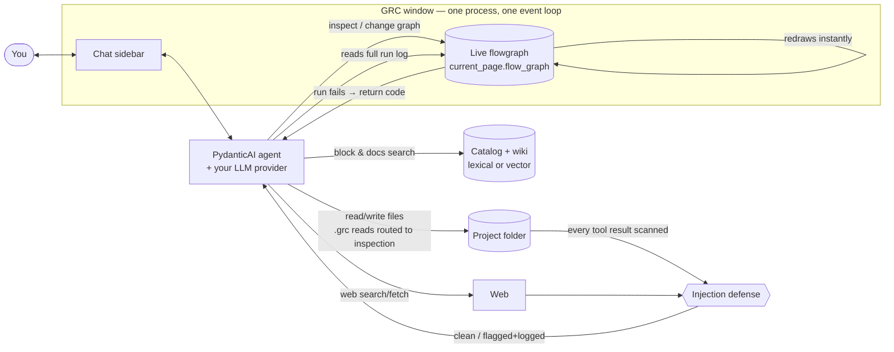
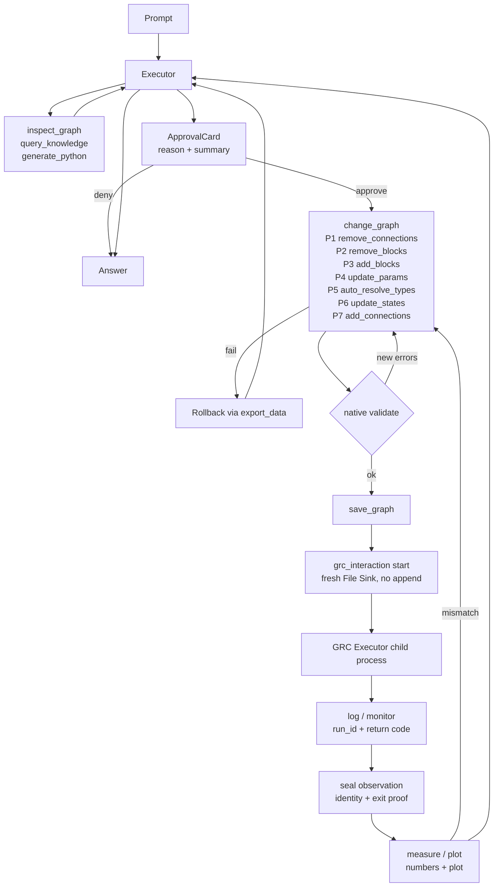

# 02 — System Design
Science-agent input. No refs or citations here by design.

## Architecture at a glance
One native GTK3 process, one thread, one event loop, one shared in-memory `FlowGraph`. PydanticAI owns the agentic loop, tool dispatch, approvals, and message history. GNU Radio Companion owns block evaluation, graph validation, code generation, and flowgraph execution. Nothing is reimplemented or round-tripped through files.

## Components

| Layer | What it is | Key files |
|---|---|---|
| Entry | GUI-only app, `pyproject.toml [project.scripts]` → `grc_agent.desktop_app:main`; no CLI, no `argparse` | `pyproject.toml`, `src/grc_agent/desktop_app.py` |
| Unified loop | `event_loop.install()` before any UI init; `gi.events.GLibEventLoopPolicy` on modern PyGObject, `gbulb.install(gtk=True)` fallback on older systems; bound to GTK default `GMainContext`; agent, canvas, tools share one thread, zero `GLib.idle_add` marshaling | `src/grc_agent/event_loop.py` |
| Shell | GRC `Application` + main window split via `Gtk.Paned`: `NativeCanvasManager` (left) + `ChatSidebar` (right); `ExecutionErrorMonitor` wired to sidebar failure callback | `src/grc_agent/desktop_app.py`, `src/grc_agent/native_canvas.py`, `src/grc_agent/chat_sidebar.py` |
| Shared graph | `NativeFlowgraphProxy` forwards every attribute access to `window.current_page.flow_graph` (`__getattr__`); follows tab switch/open/close, no reload; agent edits affect the exact object the canvas draws | `src/grc_agent/native_canvas.py:183-208` |
| Agent | PydanticAI executor (`Agent[NativeFlowgraphProxy]`) + read-only planner; streaming `Agent.iter` in `turn_driver`, `DeferredToolRequests` → `ApprovalCard` → resume; `StopGracefully(max_requests=40, max_repeated_failures=3)`, tiered compaction, injection defender | `src/grc_agent/agent_factory.py`, `src/grc_agent/agent.py`, `src/grc_agent/chat/turn_driver.py`, `src/grc_agent/deps.py` |
| Tools | `inspect_graph`, `query_knowledge`, `generate_python`, `change_graph` (approval-gated), `grc_interaction` (start approval-gated), `save_graph`, `save_block`, sandboxed fs/shell | `src/grc_agent/agent.py`, `src/grc_agent/adapter/graph.py`, `src/grc_agent/fs_tools.py`, `src/grc_agent/shell_tools.py` |
| Execution | Native `FLOW_GRAPH_EXEC` / `FLOW_GRAPH_KILL` → GRC `Executor` child process → `exec_monitor` (Messages bus: `Executing:` / `>>>Done(return code N)`) → run-id binding → retained log | `src/grc_agent/exec_monitor.py`, `src/grc_agent/native_canvas.py` |
| Evidence | File Sink `prepare_observation` → run → `seal_observation` (stat identity, exit proof) → `read_observation` (TOCTOU, alignment, nonfinite checks) → `analyze_samples` / `render_samples` | `src/grc_agent/observations.py`, `src/grc_agent/measurements.py` |

## Invariants (do not soften in the paper)
- GUI-only native desktop app; diagnostics live in the GUI (status bar, `Gtk.MessageDialog`).
- Single-process, single-thread; `event_loop.install()` exactly once.
- Canvas and agent share the exact same `FlowGraph` instance in place.
- Native GRC Python APIs only (`param.hide`, `param.category`, `Block.is_variable`, `flow_graph.is_valid()` / `validate()`, `Generator`, `export_data()`); never parse, write, or regex raw `.grc` XML.
- System prompts never enumerate tools; PydanticAI transmits JSON schemas dynamically.
- Default to standard C++ catalog blocks; `epy_block` only for custom logic with vectorized NumPy `work()`.
- Flowgraphs start/stop exclusively through native actions; never execute generated scripts via shell.
- Filesystem/shell strictly inside the project sandbox; `change_graph`, `run_command`/`start_command`, and `start` require approval.
- Never bump versions unasked (paper needs no version claim).

## Tool surface (current — use these names)

| Tool | Contract |
|---|---|
| `inspect_graph` | Semantic JSON: topology, params, connections, `validate()` state; Stage A/B pruning via uniform `keep_param()` on native metadata; omission counters only when non-empty; `file_path` from `grc_file_path` (`null` = never saved) |
| `query_knowledge` | Hybrid RRF (k=60) vector + FTS5 with C++ SWIG docstrings; `domain=catalog\|docs`, `k=1..20` |
| `generate_python` | In-memory `Generator` preview; read-only |
| `change_graph` | 7 fixed phases with rollback + Sugiyama relayout + native validation; connection strings pattern-validated; approval-gated |
| `grc_interaction` | `start` (approval-gated, bounded `stop_after_seconds`) / `stop` / `log` / `measure` / `plot` / `canvas`; captures require fresh path, matching graph/run identity, observed exit, unchanged sealed file |
| `save_graph` | Atomic save; untitled → derived name in project dir; no approval |
| `save_block` | Export `epy_block` to `~/.grc_gnuradio`; reloads library |
| fs / shell | Project-rooted; `.grc` reads → inspection, `.grc` writes denied; denylist + key scrubbing; exec approval-gated |

## Diagram A — startup and shared object

## Diagram B — edit → run → verify loop

## Error model
`ModelRetry` = retryable (bad param, invalid connection, validation failure; carries compiler/runtime feedback, consumes retry budget). `ToolFailed` = terminal (unwired monitor, missing capability; consumes no retry budget; 3 in a row ends the run via `StopGracefully`). Never describe terminal faults as prose "do not retry" — the exception type carries it.
