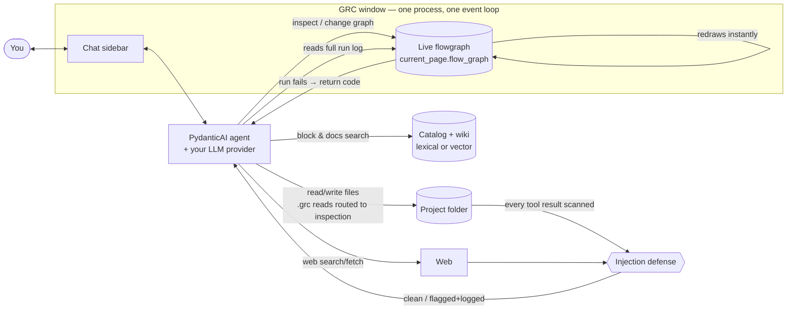
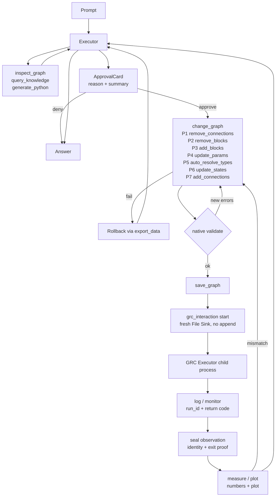

# RIA GRC-Agent — Paper Narrative (science-agent handoff)
No refs or citations here by design. Detail sources: `docs/paper-narrative/00-overview.md` through `04-evolution-pivots.md`.

## 1. Idea
RIA GRC-Agent is an AI agent for GNU Radio Companion built into the native desktop app itself. It works directly on the live `.grc` flowgraph — reading blocks, connections, and parameters structurally, editing through validated tool calls, answering grounded in GNU Radio documentation, and debugging runs. All of this happens in a chat sidebar next to the canvas the user already uses. Audience: RF/SDR engineers, testbed teams, educators, and offline shops using local retrieval and local model backends.

## 2. Features
- **Inspect and edit structurally.** Semantic read (`inspect_graph`); one transactional edit (`change_graph`, 7 fixed phases, rollback, native `validate()` gate); layered relayout so multi-step edits never degrade the canvas; native undo preserved.
- **Approval-gated by default.** Manual mode (reason + structured diff, Approve/Deny/Always accept); Auto and YOLO toggles.
- **Native run and debug.** GRC Execute/Stop actions only, never shell-executed scripts; bounded `stop_after_seconds`; failure returns return-code plus full retained log for the retry loop; read-only `generate_python` preview.
- **Measured evidence.** Unified `grc_interaction` (start/stop/log/measure/plot/canvas): fresh File Sink path → run → seal → identity/hash/TOCTOU-checked read → numbers + plot; stopped runs marked partial; canvas images are topology-only.
- **Save and reuse.** `save_graph` (untitled → project dir, atomic); `save_block` exports Embedded Python Blocks to `~/.grc_gnuradio`.
- **Sandboxed workstation.** Project-rooted fs/shell, denylist, key scrubbing; `.grc` only via graph tools; every tool/web result scanned by injection defense (flag + log).
- **Grounded knowledge.** Lexical FTS5 default (zero-download) plus optional local-vector fusion via RRF (k=60) over C++ SWIG docstrings + wiki; standard C++ (VOLK) catalog default, vectorized-NumPy `epy_block` only for custom logic.
- **Providers and sessions.** Hot-swappable backends without restart; persistent sessions with tiered compaction; live cost/context readout; uniform `ModelRetry` (retryable) vs `ToolFailed` (terminal) errors.

## 3. System design
One GTK3 process, one thread, one event loop, one shared in-memory `FlowGraph`. Entry is `grc_agent.desktop_app:main` (GUI-only, no CLI). `event_loop.install()` unifies asyncio with GLib (`gi.events` primary, `gbulb` fallback) before any UI init. `NativeFlowgraphProxy` forwards every access to `window.current_page.flow_graph` — canvas and agent touch the exact same object, no reload. PydanticAI owns loop, dispatch, approvals, and history (executor + read-only planner); GRC owns evaluation, validation, codegen, and execution. Native APIs only — never raw `.grc` XML. Execution goes through `FLOW_GRAPH_EXEC`/`KILL` into a child process watched by `exec_monitor`; evidence flows back through retained logs and sealed File Sink observations.

## 4. Flows
**Edit:** inspect → propose → approve → transactional change → relayout → redraw → validate. **Run-measure:** fresh sink → start (approved, optionally bounded) → child runs → stop/log → sealed measure/plot → loop back on mismatch. **Planner handoff:** read-only planner writes a durable plan; executor receives it via system reminder without auto-replanning. Gates: `change_graph`, `start`, `run/start_command` require approval; stop/log/measure/plot/canvas/save do not; out-of-sandbox, secret, and raw-`.grc` operations are denied.

## 5. Evolution and pivots (593 commits, 2026-04-07 → 2026-10-23)
Prototype and retrieval scaffolding (Apr–May, `0a5f2d0`, `2678469`) gave way to a prompt-folklore and out-of-process GUI detour (`f3f493e`, Broadway/PySide6 experiments). The native pivot (Jun 18–24) deleted the CLI (`2bb0a6c`), killed allowlists and regex heuristics (`9d6ec88`), added the native adapter (`e9591e7`), and removed ~4200 lines of dead code (`c455acc`). Single-process convergence (Jul 15–Aug 18) rewrote the app as native GTK3 (`5038dfc`), unified the loop (`4417211`), and adopted the PydanticAI harness (`6c345eb`). Product hardening since (sandboxed fs `189cf1e`, hybrid RRF `e437987`, verified `grc_interaction` `9b2ddf8`) has been additive only. The pattern across pivots: hand-rolled copies, prompt tricks, and side processes failed on divergence, brittleness, and desync; each fix deleted code and moved authority to its owner — GRC for graph truth and execution, the loop bridge for scheduling, PydanticAI for the agent loop, standard fusion for retrieval. Full phase table with hashes: `04-evolution-pivots.md`.
