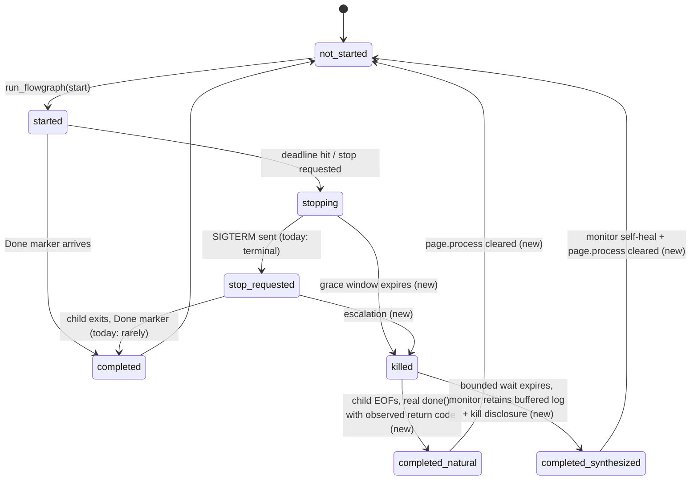
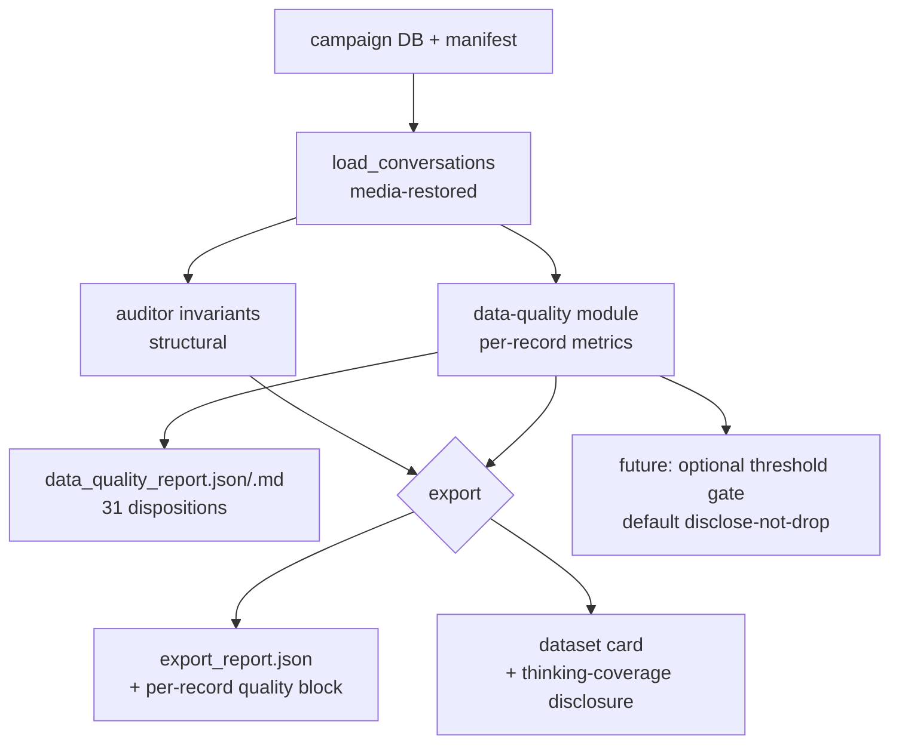

# Run-Monitor, Simulator-Contract, and SFT-Corpus Defect Remediation - Plan

## Goal Capsule

- **Objective:** Every mechanism that corrupted the 2026-09-10/11 SFT collection campaign — the "No flowgraph has been run yet" log lies, the premature simulator give-ups on productive turns, the stuck-run wedges — has a proven root cause, a merged fix, and a green proof gate that blocks any future collection spend until functionality is demonstrated end-to-end.
- **Means:** Two evidence-first investigations (run-marker path, provider reasoning behavior) feed app-side stop/monitor fixes, harness-side simulator-contract fixes, and a per-record data-quality disposition of the existing corpus (KTD1–KTD6).
- **Execution profile:** App fixes land in `src/` (authorized this session, reversing the collection-time freeze); harness fixes land in the nested `experiments/dataset_collection` repo; all live LLM work runs inside the campaign sandbox via `./run-campaign.sh`.
- **Authority hierarchy:** AGENTS.md invariants (single-thread unified loop, native GRC execution, no silent transformations, `ModelRetry`/`ToolFailed` discipline) govern every unit; the collected corpus is immutable — reports annotate, never rewrite.
- **Stop conditions:** If U1 proves the Done-marker starvation lives in GNU Radio's `ExecFlowGraphThread` such that no app-side fix can retain logs, stop and report — do not patch system-owned code. If a session-settled decision (data retention, proof-before-spend) is invalidated by evidence, halt and surface it.

---

## Product Contract

### Summary

Diagnose and fix the three failure families that poisoned the dataset-collection campaign, produce a per-record quality disposition for all 31 collected records without moving any data, and install a functionality-proof gate that must pass before any future collection campaign spends a token.

### Problem Frame

The 2026-09-10/11 collection sweep spent 15.45M input tokens and produced 12 primary rows that cannot be trusted: the teacher was repeatedly told "No flowgraph has been run yet" after runs that demonstrably executed (a file sink captured 491,492 bytes); the simulated user abandoned sessions because "blank replies" that were actually productive tool-call turns; bounded runs wedged the run monitor so later starts went unanswered. The corpus is small because sessions died to infrastructure defects, and parts of it ship assistant turns with no reasoning trace. The operator halted collection, kept the data, and directed that the defects be proven, documented, and fixed in our code before anything is collected again.

### Requirements

Data disposition

- R1. Every one of the 31 collected records carries a machine-computed quality entry (thinking coverage, empty-turn counts, dead-log-read counts, trailing unanswered calls, satisfaction/verdict mismatch flags) and a disposition label — trustworthy, suspect, or condemned — in a durable report. No record, export file, or manifest row is moved, rewritten, or deleted.

Root-cause evidence

- R2. Each failure family has a written root-cause verdict backed by reproduction evidence: (a) retained-log loss on runs that executed, (b) the stuck-monitor wedge after a bounded run's stop, (c) assistant turns arriving with empty content/thinking, including the simulator's JSON-abort path.

Fixes for our defects

- R3. A bounded run's stop escalates (SIGTERM, then grace window, then SIGKILL), the monitor retains the captured output of a killed run with explicit termination disclosure, and the monitor recovers so consecutive start/stop cycles work without restart.
- R4. The simulator receives a truthful "what the user saw" signal that reflects tool activity during work-in-progress turns, and counts a give-up streak only across turns with neither text nor tool activity.
- R5. The simulator's JSON-abort path retries without appending the failed exchange, and the manifest records reasoning-presence per simulator call.
- R6. The auditor/exporter expose the R1 quality metrics, and future exports carry them in the export report and dataset card.

Proof gate

- R7. A documented proof gate (hermetic conformance checks plus one live sandboxed smoke task) is green and recorded in `sandbox/GO-NOGO.md` before any collection campaign command is allowed to run; the campaign launcher refuses otherwise.

Disclosure

- R8. Every behavioral change above is disclosed where the model or operator sees it: retained partial logs carry their truncation/termination provenance, quality metrics appear in the dataset card, and the gate status is visible in campaign output.

### Key Decisions

- KD1. Stop collection now; keep all collected data exactly as-is; audit-only on the corpus. `Governs R1` (session-settled: user-directed — chosen over continuing the retry sweep or discarding the corpus).
- KD2. No new collection spend until complete functionality is proven by the R7 gate. `Governs R7` (session-settled: user-directed — chosen over collect-then-verify).
- KD3. Our-side defects are fixed in `src/` where the evidence places them; the collection-time freeze on `src/` is lifted for this remediation. `Governs R3, R4, R5` (session-settled: user-directed — chosen over harness-only workarounds).
- KD4. Re-collection campaign design is deferred to a follow-up plan; this plan ends at fixes merged, quality report delivered, and gate green. `Governs R7` (session-settled: user-approved — confirmed in the scoping call-outs).

### Success Criteria

- SC1. Under xvfb: start a flowgraph, let a bounded run hit its deadline or stop it mid-run, and `get_run_log` returns that run's real output with termination/truncation disclosure; three consecutive start/stop cycles complete without a stuck monitor or app restart.
- SC2. A scripted session with tool-call-only turns shows the simulator receiving non-empty activity-aware replies and never entering the give-up path while work is progressing.
- SC3. The quality report covers all 31 records, its per-record counts reconcile with `export_report.json`, and each record has a disposition label.
- SC4. `sandbox/GO-NOGO.md` records the proof gate green with date and evidence, and the campaign launcher demonstrably refuses to start a campaign without it.

### Scope Boundaries

- Re-collection campaign design and execution — deferred to a follow-up plan (KD4).
- Model/provider selection changes — deferred until U2's characterization evidence exists.
- Expanding the task library (documented review #18 gap) — out of scope.
- Patching system-owned GNU Radio sources (`/usr/lib/python3/dist-packages/gnuradio/...`) — out of scope; we fix at our layer only.
- Uploading or redistributing the corpus — out of scope.

---

## Planning Contract

### Key Technical Decisions

- KTD1. Stop escalation and partial-log retention live in our layer, with four pinned decisions:
  (a) **Status vocabulary is frozen.** Tool-level run statuses never gain a kill-specific name — the set stays `completed`, `still_running`, `not_started`, `not_running`, `started`, `stopped`, `stop_requested`, `stopped_after_timeout` — and kill provenance travels only in disclosure fields (`terminated_by_kill: true`, `termination_signal`). Rationale: the harness's `flowgraph_ran` predicate allowlists `completed|stopped_after_timeout` (`collection/runner.py` `_session_ran_flowgraph`); a new status silently condemns good sessions. This also fixes a pre-existing defect the review surfaced: a successful manual stop returns `stopped` (`stop_flowgraph`), which the allowlist already misclassifies as never-executed — the allowlist is corrected to accept every terminal ran-status (`stopped` included), with a vocabulary-conformance test asserted in both suites that enumerates the app's `run_flowgraph`/`stop_flowgraph` return sites rather than restating a hand-copied constant.
  (b) **Kill topology is verified, not assumed.** `Executor._popen` spawns without `start_new_session`, so the child shares the app's process group — `killpg` on the child's pgid would SIGKILL the GUI itself. Escalation kills the direct PID; descendants are killed only when the direct child is a terminal wrapper (`no_gui`/xterm case, where killing the direct PID would not EOF the stdout pipe), decided via `getpgid` checks at escalation time.
  (c) **Natural path first.** After SIGKILL, the app waits a bounded window for the *natural* Done marker (the dead child's stdout EOFs, `ExecFlowGraphThread.run()` returns, real `done()` fires with the observed return code `-9`) and only synthesizes if it does not arrive — the `-9` is observed wherever possible, never fabricated; `return_code` stays observed-or-absent, `ran_successfully` is `False` for any kill, and the synthesis never fires the `on_error`/`notify_run_failure` failure callback (a deliberate bounded stop is not a failure turn).
  (d) **The start gate is part of the fix.** `run_flowgraph`'s "already in progress" pre-gate reads `page.process`, which only system-owned `done()` clears — U3 clears it explicitly on escalation (mirroring `done()`'s own semantics), or the next start wedges regardless of monitor state.
  All waits in the escalation path are `asyncio`-based with an injectable clock (a blocking sleep freezes the whole unified loop); a real Done marker arriving during the grace window cancels the escalation; double-terminal arrival is idempotent. `Governs R3, R8`; cites KD3.
- KTD2. The retained-log and wedge root cause is established by instrumentation before the fix shape is frozen (child-side `tb.wait()` deadlock vs. idle-callback starvation vs. both); the U1 memo is the authority. An idle-dispatch or child-watcher change in `src/grc_agent/event_loop.py` is made only if starvation or the `NotImplementedError` reap race is proven. `Governs R2`; cites KD3.
- KTD3. The simulator's reply contract becomes work-aware: the runner derives "what the user saw" as the last response's text plus a neutral activity line naming tool categories used that turn, and the unproductive-streak counter only fires on turns with neither text nor tool activity. The tool-name→category mapping is one uniform registry-derived rule in the contract builder (prefix/registry lookup with a defined default — a generic "working on the flowgraph" sentence for unknown tools), never a per-tool hand-written table; activity lines never carry tool arguments, block names, or paths. `Governs R4`; cites KD3.
- KTD4. The simulator's abort path retries once from the same context without appending the failed exchange (the current repair appends and grows the very history that correlates with aborts), and every simulator call logs whether `reasoning` was present alongside `content` for A-35 telemetry. `Governs R5`; cites KD3.
- KTD5. Existing corpus disposition is report-only, with the write surface pinned: the quality module emits **new** files (`data_quality_report.json`/`.md`) that collide with no corpus artifact — it never re-invokes `export_campaign` against the live `export/` directory (that path rewrites all five export artifacts in place and would destroy byte-traceability with the shipped zips, which stay frozen); a per-record quality block for `export_report.json` is emitted only to a versioned new path, keyed by the exact `_report_key` (`t01_dial_tone#2`-style) with a schema-version field, existing keys' meanings frozen. Metrics are computed and named on **both** surfaces (`history_*` from the deserialized session, `exported_*` from the truncated/scrubbed row as `export_campaign` builds it); mismatch flags are structural (simulator `satisfied` vs record verdict, both directions) with `reason` surfaced verbatim — no prose classification. Reproducibility: the report header records `campaign_id`, campaign-DB sha256 (+ WAL/sidecar state), harness HEAD, and library versions; DB reads go through a checksummed copy; per-record media-restore or deserialize failure yields `metrics_unavailable: <reason>` and a non-zero report exit — never a silent zero-count, never a whole-report crash. If the DB is lost, the report emits manifest-only metrics and marks DB-derived metrics `unavailable` (no pseudo-derivation). Coverage is defined over the 31 manifest task records; records without a usable session row get manifest-only metrics and a verdict-only disposition (they are non-shipped by construction). Future-export threshold: metric = thinking coverage of exported assistant rows, default = disclose-not-drop, knob lives on the export CLI; the threshold never re-classifies already-shipped rows (a 31-record corpus makes any drop unrecoverable). `Governs R1, R6, R8`; cites KD1.
- KTD6. The proof gate has two tiers, both required: (1) hermetic conformance — the repo fast gate plus new tests covering kill-escalation retention, monitor self-heal across consecutive stops, and the work-aware reply contract; (2) one live sandboxed smoke task with explicit pass criteria (bounded run's log non-empty with disclosure, thinking present on reasoning turns, three clean start/stop cycles, simulator give-up not fired). `sandbox/GO-NOGO.md` gains a blocking section with a machine-readable record (one line: date, harness HEAD hash, smoke task id, status), and the campaign stage refuses to run without a green record whose HEAD matches the current harness HEAD. The refusal gates only spend-bearing stages; `audit`, `export`, `shell`, and the U1/U2 investigation spends are legitimate before the gate. `Governs R7`; cites KD2.

### High-Level Technical Design

Run lifecycle today and after the fix (state machine — state names below are monitor-internal; the tool-level status vocabulary is frozen per KTD1a and gains no kill-specific names):

Collection pipeline quality gates (data flow):

### Assumptions

- The idle-callback starvation hypothesis for the Done marker may be disproven by U1 (the child-side `tb.wait()` deadlock may explain everything); U4 exists only for the proven branch.
- GLM's empty-content-on-tool-call-turns is provider behavior we cannot fix, only characterize, tolerate, and disclose; if U2 shows a request-shape trigger (e.g., history length), a harness mitigation may be proposed in the follow-up plan, not this one.
- The campaign DB at `~/grc-campaign-sandbox/campaign/.grc_agent/chat_sessions.db` remains available for U2's replay and U7's metrics; if it is lost, the report emits manifest-only metrics and marks DB-derived metrics `unavailable` — no pseudo-derivation, per KTD5.

### Sources / Research

- Repo terrain map (subagent report, this session): `ExecFlowGraphThread._popen/run/done` in `/usr/lib/python3/dist-packages/gnuradio/grc/gui/Executor.py` (per-char pipe drain via `GLib.idle_add`; `done()` is the only Done-marker producer); marker shapes in `gnuradio/grc/core/Messages.py`; SIGTERM template `sig_handler` (`tb.stop(); tb.wait(); Qt.QApplication.quit()`) in `gnuradio/grc/core/generator/flow_graph.py.mako`; SIGTERM-only stop in `gnuradio/grc/gui/Application.py` `FLOW_GRAPH_KILL`.
- App-side path: `src/grc_agent/exec_monitor.py` (`handle_message`, `get_last_run_log`, `wait_for_run_end`, `_run_epoch`), `src/grc_agent/native_canvas.py` (`run_flowgraph`, `_finish_bounded_run`, `stop_flowgraph`), `src/grc_agent/agent.py` `get_run_log_func` (the "No flowgraph has been run yet" payload), `src/grc_agent/desktop_app.py` monitor wiring, `src/grc_agent/agent_factory.py` (`OllamaModel` + `OllamaProvider(base_url='https://ollama.com/v1')` for `ollama_cloud`; empty `ModelSettings`; the `_retrying_http_client` tenacity transport).
- Provider capture: installed pydantic-ai 2.37.0 — `models/openai.py` `_process_thinking`/`_map_thinking_delta` read `reasoning` then `reasoning_content`; `providers/ollama.py` hardcodes `openai_chat_thinking_field='reasoning'`; `profiles/__init__.py` documents the Ollama+Qwen3 empty-text-before-tool-calls shape as tolerated; `models/ollama.py` `_routes_to_ollama_cloud` disables cloud json_schema enforcement. Teacher requests are streaming (`src/grc_agent/chat/turn_driver.py` `agent.iter` + `node.stream()`); `<think>` tag splitting is default.
- Harness surfaces: `experiments/dataset_collection/collection/contract.py` (`last_assistant_text`, `drain`, `run_tracking`), `collection/runner.py` (`_stop_run` escalation + `monitor._tracking = False` reconciliation, give-up counter), `simulation/client.py` (`_parse_turn`, repair-append path), `verification/invariants.py` (`thinking_count` defined but ungated), `exporter.py` (`map_messages` thinking derivation, empty-turn handling, `_unanswered_tool_calls`).
- Campaign evidence: `experiments/dataset_collection/docs/AUDIT-2026-09-09.md` Addenda 6–7 (A-31–A-35), session-trace inventory in the Appendix.

---

## Implementation Units

### Phase 1 — Evidence first

### U1. Instrumented root-cause reproduction: Done-marker delivery and child exit

- **Goal:** A written verdict, backed by an instrumented xvfb reproduction, distinguishing why the Done marker never arrives: child-side hang (`tb.wait()` deadlock on SIGTERM), idle-callback starvation on the unified loop, or both.
- **Requirements:** R2 (families a, b).
- **Dependencies:** none.
- **Files:** new `docs/investigation/2026-09-11-run-marker-root-cause.md` (verdict memo); temporary instrumentation in `src/grc_agent/exec_monitor.py` and around `ExecFlowGraphThread` via a debug launcher under `playground/` (removed or `DEBUG`-gated before merge).
- **Approach:**
  1. Reproduce the campaign shape under xvfb: boot the app, open a qt_gui graph with a file sink, `run_flowgraph` bounded (4–6 s) and unbounded + `stop`.
  2. Log, with timestamps: child PID and exit status per signal stage (SIGTERM, grace window, SIGKILL), `ExecFlowGraphThread.run()` EOF, `done()` entry, `handle_message` marker sightings, `_tracking`/`_run_epoch` across three consecutive start/stop cycles.
  3. Starvation probe: enqueue a permanently-ready higher-priority GLib source and observe whether `done()` still dispatches; separately, run a graph that ignores stop to force the child-hang path.
  4. Record which branch(s) reproduce, and capture the child-watcher `NotImplementedError` reap-race conditions in the same memo.
- **Test expectation: none — investigation unit; its output gates U3's design and U4's existence.**
- **Verification:** The memo names the reproduced mechanism(s) with logged evidence and states which of U4's branches (if any) are live; the harness's `_stop_run` reconciliation comment ("no terminal marker arrives") is confirmed or corrected.

### U2. Provider characterization: empty content/reasoning turns and simulator JSON aborts

- **Goal:** A written characterization of GLM-5.3-flash:cloud's empty-`content`/empty-`reasoning` behavior under the app's exact request shapes, settling A-35 with evidence.
- **Requirements:** R2 (family c).
- **Dependencies:** none (parallel with U1).
- **Files:** new `docs/investigation/2026-09-11-glm-empty-turn-characterization.md`; replay script under `experiments/dataset_collection/` (sandbox-invoked only).
- **Approach:**
  1. Replay 3–5 captured campaign histories (from the campaign DB, sanitized) against `https://ollama.com/v1` inside the sandbox via `./run-campaign.sh shell` — once with the app's streaming path, once non-streaming — recording per call: content length, reasoning presence/length, tool calls, finish reason.
  2. Correlate empty-reasoning/empty-content incidence with history size and tool-call-turn shape (the campaign showed 82 no-think turns, all tool-call-bearing).
  3. Post the simulator's exact `format`-constrained body (JSON object grammar) N times at varying history lengths; record brace-less/empty `content` incidence and whether `reasoning` co-occurs.
  4. Budget: cap total spend at ~0.5M input tokens, enforced mechanically (the replay script aborts at the cap, not by prose discipline); abort and report if the correlation is not establishable within budget.
  5. Egress hygiene: every replayed history passes the harness's one uniform scrub rule (`filter_secrets`) over every text-bearing part before egress, with per-call redaction counts disclosed in the memo; histories from records quarantined for redactions are replayed only scrubbed and flagged. The memo carries a replay disclosure (what was re-sent, to which provider, when, how many calls) — replay is a new upload purpose beyond the dataset card's collection disclosure.
  6. Ordering note: this spend precedes the U8 gate by design (investigations are not collection); the gate's refusal scope in KTD6 excludes it.
- **Test expectation: none — investigation unit; output feeds KTD4's telemetry design and the follow-up plan's model decision.**
- **Verification:** The memo states incidence rates with sample sizes, confirms or refutes the long-history correlation, and gives a recommendation (tolerate+disclose vs. request-shape mitigation) for the follow-up plan.

### Phase 2 — Fixes

### U3. Stop escalation, partial-log retention, and monitor self-heal

- **Goal:** A bounded run's stop always reaches a terminal, truthful state: log retained with kill provenance, monitor reset, next start functional.
- **Requirements:** R3, R8; cites KTD1.
- **Dependencies:** U1 (confirms the child-side branch and informs the grace window; the escalation itself proceeds regardless — the current state is strictly worse).
- **Files:** `src/grc_agent/native_canvas.py` (`stop_flowgraph`, `_finish_bounded_run`, `_build_run_result`, and the `page.process` start gate), `src/grc_agent/exec_monitor.py` (natural-path-first synthesis; `_tracking`/`_run_epoch` recovery; expose `run_epoch` as a `run_id` field in `get_last_run_log`), `src/grc_agent/agent.py` (`run_flowgraph_func` docstring vocabulary; `get_run_log_func` None branch), `tests/test_exec_monitor.py`, `tests/test_run_stop_tools.py`, `tests/test_native_canvas.py`, `experiments/dataset_collection/collection/runner.py` (`_session_ran_flowgraph` allowlist correction, `_log_fingerprint`, post-kill reconciliation comment), `experiments/dataset_collection/tests/test_acceptance.py` and `experiments/dataset_collection/tests/test_collection.py` (harness allowlist and fingerprint conformance).
- **Patterns to follow:** the existing SIGTERM carve-out and truncation-disclosure fields in `exec_monitor.py`; the harness's escalation ladder in `collection/runner.py` `_stop_run` (wait → terminate → kill → reap), folded into the app where it belongs.
- **Approach:**
  1. Escalation ladder in `stop_flowgraph`/`_finish_bounded_run`: SIGTERM → grace window (asyncio waits with an injectable clock — a blocking sleep would freeze the unified loop) → SIGKILL of the direct PID (descendants only when the direct child is a terminal wrapper, per KTD1's `getpgid` rule) → bounded wait for the natural Done marker (the dead child's stdout EOFs, real `done()`, observed return code) → only then synthesize.
  2. Synthesis retains the buffered `_chunks` output with disclosure fields (`terminated_by_kill: true`, `termination_signal`), keeps `return_code` observed-or-absent, sets `ran_successfully: False`, never fires the `on_error`/`notify_run_failure` callback, clears `_tracking`, advances `_run_epoch`, and clears `page.process` so the real start pre-gate passes (KTD1d).
  3. Vocabulary: no new status names; the harness `_session_ran_flowgraph` allowlist is corrected to accept every terminal ran-status including the pre-existing `stopped` defect; a vocabulary-conformance test asserts the same status set in both suites.
  4. Expose the monitor's `run_epoch` as `run_id` in `get_last_run_log` and include it in the harness's `_log_fingerprint` — two consecutive quiet killed runs would otherwise collide on `(\"\", -9)` and false-fail the stale-log guard.
- **Test scenarios:**
  - Happy path: monitor tracking with buffered chunks → synthesis → `get_last_run_log` returns the buffered text with kill disclosure and `run_in_progress: False`.
  - Edge: synthesis while not tracking → no-op, no duplicate retention.
  - Edge: chunks empty at kill → retained log is empty string with the same disclosure fields, never `None` (the model must distinguish "ran, no output captured" from "never ran").
  - Edge: real Done marker arrives during the grace window → escalation cancelled, natural terminal wins; late marker after synthesis → idempotent no-op.
  - Error path: child ignores SIGTERM → escalation fires after the grace window, kill delivered per the verified topology, terminal state synthesized within the worst-case wall time (SIGTERM + grace + kill, ~10–30 s) inside one tool call.
  - Error path: escalation path contains no blocking sleep (assert via the injectable clock; a frozen loop would stall GUI + agent streaming).
  - Integration: three consecutive start → bounded-stop cycles on one page end with correct epochs, no stuck `_tracking`, cleared `page.process`, and each run's log independently retained — the real start pre-gate must pass, not just monitor state.
  - Integration: `run_flowgraph(start)` immediately after an escalated kill proceeds (no "already in progress").
  - Integration (harness): two consecutive killed runs in one session produce distinct fingerprints (stale-log guard does not false-fire).
- **Verification:** Repo fast gate green including the new tests; the harness's post-kill `monitor._tracking = False` reconciliation in `collection/runner.py` becomes redundant — kept or removed with a comment referencing the app-side fix.
- **Execution note:** Implementation follows U1's memo; if U1 shows idle starvation is the dominant mechanism, coordinate U4 rather than widening the grace window blindly.

### U4. Marker-delivery or reap fix on the unified loop (contingent)

- **Goal:** If U1 proves Done-marker starvation (idle sources not dispatched) or the child-watcher `NotImplementedError` reap race, fix the delivery/reap mechanism in `src/grc_agent/event_loop.py` (or the watcher installation) so marker delivery does not depend on the unproven branch.
- **Requirements:** R2, R3; cites KTD2.
- **Dependencies:** U1 (existence is conditional on its verdict).
- **Files:** `src/grc_agent/event_loop.py`, `tests/test_event_loop.py` (loop-level tests), possibly `src/grc_agent/exec_monitor.py`.
- **Approach:** Follow the U1 evidence: if idle starvation — ensure the installed loop dispatches GLib idle-priority sources (iteration/attachment fix); if watcher race — install a child watcher compatible with the unified loop or reap via the existing harness pattern. Respect the single-thread invariant absolutely; no cross-thread marshaling additions.
- **Test seam:** `tests/test_event_loop.py` (the loop's own suite — `tests/test_desktop_app.py` has no loop-level tests); new dispatch-priority and watcher cases live there.
- **Test scenarios:**
  - Edge: a permanently-ready higher-priority source does not delay marker delivery beyond one loop iteration (regression for the starvation branch, only if proven).
  - Error path: SIGTERM'd child reaped mid-teardown does not raise `NotImplementedError` into the model request path (regression for the watcher branch, only if proven).
- **Verification:** The U1 repro scenario passes without instrumentation; repo fast gate green.
- **Test expectation:** none if U1 disproves both branches — unit is closed with a memo reference instead.

### U5. Work-aware simulator reply contract

- **Goal:** The simulated user perceives productive tool-work turns as activity, not silence; give-ups fire only on genuinely unproductive streaks.
- **Requirements:** R4; cites KTD3.
- **Dependencies:** none (parallel with U3).
- **Files:** `experiments/dataset_collection/collection/contract.py` (`last_assistant_text` → work-aware builder), `collection/runner.py` (give-up counter feed, `TurnRecord.reply`), `tests/test_collection.py`.
- **Approach:** Build the reply from the last `ModelResponse`: joined text plus, when text is empty or the turn made tool calls, one neutral activity sentence derived from the turn's tool-name categories (edit/run/inspect/read verbs mapped from tool names — categories, never arguments or block names). Keep `last_assistant_text` for any caller wanting raw text; the simulator feed uses the new builder. The unproductive counter moves from "empty reply" to "no text AND no tool activity since the last user-visible turn".
- **Test scenarios:**
  - Happy path: turn with `run_flowgraph` tool call, empty text → simulator reply contains the run-activity sentence; give-up counter resets.
  - Happy path: turn with text → reply is the text (activity sentence only when text is empty or beside tool calls, per KTD3's shape).
  - Edge: three consecutive turns with neither text nor tool activity → give-up counter reaches its threshold and fires as before.
  - Edge: activity sentence never contains tool arguments, block names, or file paths (assert on a tool-call turn carrying args).
  - Integration: scripted mini-campaign (hermetic) where the teacher tool-calls for 3 turns then completes → simulator does not abandon.
- **Verification:** Harness suite green; the dry run's scripted turns exercise the new reply shape (`xvfb-run` dry run OK).

### U6. Simulator abort retry-without-append and reasoning telemetry

- **Goal:** A brace-less JSON abort costs one clean retry instead of one poisoned-context retry, and every simulator call records whether reasoning accompanied the content.
- **Requirements:** R5; cites KTD4.
- **Dependencies:** none (parallel with U3/U5).
- **Files:** `experiments/dataset_collection/simulation/client.py` (`next_turn` abort path), `tests/test_simulation.py`.
- **Approach:** On `_parse_turn` failure, keep the existing in-history repair attempt (appended exchange), then retry once more from the same pre-failure context without appending (three provider calls total: initial, repair, clean retry; abort only after the third failure). Record `reasoning_present` per call into `SimulatorTurn.raw` so the manifest carries it (the simulator response's sibling `reasoning` field is currently read by nothing).
- **Test scenarios:**
  - Happy path: valid JSON first try → behavior unchanged; `reasoning_present` recorded.
  - Error path: brace-less content, valid on the in-history repair → turn parsed from the repair (two calls), manifest shows both attempts.
  - Error path: brace-less on initial and repair, valid on the clean retry → turn parsed (three calls), manifest shows all three attempts and the failed payloads preserved for context.
  - Error path: brace-less on all three → `SimulatorAborted` as today, with telemetry intact.
  - Edge: `reasoning` present but `content` brace-less → telemetry records the asymmetry (the A-35 signature) before aborting.
- **Verification:** Harness suite green; one sandboxed live call spot-check during U2's session confirms the telemetry field lands in `turns.jsonl`.

### U7. Data-quality audit module and per-record disposition report

- **Goal:** All 31 collected records carry machine-computed quality metrics and a disposition label, delivered as a durable report; export/report surfaces expose the same numbers.
- **Requirements:** R1, R6, R8; cites KTD5.
- **Dependencies:** none (parallel; consumes the existing campaign DB snapshot).
- **Files:** new `experiments/dataset_collection/verification/data_quality.py`, report emission wired from `audit.py`/`export.py` as new-versioned outputs (never re-invoking `export_campaign`), future-export surfaces in `exporter.py` (per-record quality block, dataset-card thinking-coverage disclosure) and the `export` CLI entry point (threshold knob), tests (new `tests/test_data_quality.py`), report outputs to new file names under the campaign dir (`data_quality_report.json`/`.md`) plus the committed deliverable copy in the harness repo.
- **Approach:** Per record compute metrics on **two named surfaces** (KTD5): `history_*` from the media-restored deserialized session (assistant-turn count, empty-text turns, fully-empty turns with/without tool calls, dead-log-read count via a named constant matching `agent.py`'s exact tool-return payload, trailing unanswered calls) and `exported_*` from the row as `export_campaign` builds it (thinking coverage, message counts). Mismatch flags are structural: simulator `satisfied` vs record verdict, both directions, with `stop_reason` surfaced verbatim — no prose parsing. Disposition: `condemned` requires wedge evidence consistent with the manifest verdict (trailing unanswered calls or never-executed runs on run-required goals — never condemn a completed+accepted record on DB shape alone; the t11 satisfaction-mismatch shape is flag-plus-`trustworthy`), `suspect` for shipped-row impact (dead-log returns that ship as `role:"tool"` content, or exported rows with missing thinking), else `trustworthy`; every label carries its triggering counts. Write guardrails: `_atomic_write` only; refuse-if-exists with an explicit overwrite flag (overwriting a derived report must be visible); DB read through a checksummed copy (validate-real-db pattern); never write into `campaign/export/` or `.grc_agent/`. Reproducibility: report header carries `campaign_id`, campaign-DB sha256 + WAL/sidecar state, harness HEAD, library versions; a per-record media-restore or deserialize failure produces `metrics_unavailable: <reason>` and a non-zero exit — never a silent zero-count; if the DB is absent, manifest-only metrics with DB-derived fields marked `unavailable`. Coverage: all 31 manifest task records; the 3 records with `session_id: null` get manifest-only metrics and a verdict-only disposition. The `export_report.json` quality block (future exports) keys by exact `_report_key` under a schema-version field; existing keys frozen.
- **Test scenarios:**
  - Happy path: fixture campaign with a clean completed record → metrics all zero/clean, disposition `trustworthy`.
  - Future-export surface: fixture export run with a low-thinking-coverage completed record → quality block present with the coverage value, dataset card carries the disclosure line, threshold knob at its default leaves the row's disposition to the report (disclose-not-drop); knob set to drop → row quarantines with a named quality reason.
  - Edge: record with a tool-call-only turn missing thinking in its exported row → `suspect`, count surfaced on both surfaces.
  - Edge: record ending in unanswered tool calls → `condemned`, matching the existing exporter refusal rules.
  - Edge: satisfaction-mismatch record (dissatisfied-stop semantics vs verdict disagreement, structural) → flagged with `stop_reason` verbatim; disposition follows the deliverable, not the flag (t11 pattern).
  - Edge: media-restore failure on one record → that record reports `metrics_unavailable`, report exit non-zero, other records unaffected.
  - Edge: report file already exists → refused unless the overwrite flag is set.
  - Integration: run against the real campaign DB copy → all 31 manifest records covered (3 manifest-only), counts reconcile with `export_report.json` by key identity.
- **Verification:** Harness suite green; the generated report over the real campaign directory is committed as the deliverable artifact and cited from the audit doc's next addendum; the pre-existing `export/` files are byte-identical before/after (checksummed).
- **Execution note:** Read-only against the corpus; the report lands under new names in the campaign dir and a copy is committed in the harness repo. The shipped zips are NOT rebuilt in this unit (KD1/KTD5) — the follow-up plan owns any re-ship.

### Phase 3 — Gate

### U8. Functionality-proof gate wired into GO/NOGO and the launcher

- **Goal:** No collection campaign can spend until the proof gate is green and recorded.
- **Requirements:** R7, R8; cites KTD6, KD2.
- **Dependencies:** U3, U5, U6, U7 merged (the gate exercises their behavior); U1/U2 memos exist (the gate checklist cites them).
- **Files:** `experiments/dataset_collection/sandbox/GO-NOGO.md` (new blocking section F), `sandbox/run-campaign.sh` (campaign stage reads the gate record; refuses without it), new `sandbox/proof-gate.sh` (or a documented checklist driven by existing stages), `docs/AUDIT-2026-09-09.md` addendum for the gate's first green run.
- **Approach:** Tier 1 (hermetic): repo fast gate, harness suite, xvfb GUI tests, sandbox `gates` + `dryrun` — all existing stages. Tier 2 (live): one sandboxed smoke task with pass criteria: bounded run's `get_run_log` non-empty with disclosure; reasoning present on non-tool-call assistant turns; three clean start/stop cycles; simulator give-up not fired; audit + export + round-trip green; real DB byte-identical. The gate record is machine-readable (one line: ISO date, harness HEAD hash, smoke task id, status) in GO-NOGO.md plus the smoke task's export artifact; `run-campaign.sh campaign` refuses unless a green record matches the current harness HEAD (printed reason, not silent).
- **Test scenarios:**
  - Happy path: gate green recorded → `campaign -- --tasks ...` proceeds past the check.
  - Error path: no record, or record older than harness HEAD → launcher refuses with the reason; `audit`/`export` stages remain available (they do not spend).
  - Edge: harness commit changes after a green record → gate is stale, refusal until re-run.
- **Verification:** Demonstrate both branches in-sandbox (refuse, then pass after recording); the smoke export lands in the campaign export dir and is cited from the GO-NOGO line.
- **Execution note:** The smoke task consumes real tokens (~0.7M expected); run it only after Tier 1 is green and U2's budget is closed.

---

## Risks & Dependencies

- RISK1. System-owned upstream skew — `Executor.run/done` semantics (per-char `GLib.idle_add` drain, EOF→`done()`, `page.process` clearing) are load-bearing for both the fix and the natural path; a distro GNU Radio update silently changes them. *Mitigation:* U1 pins behavior to the installed version; the synthesis path is the bounded fallback; the gate records the version. *Detection:* three-cycle integration test + U8 smoke.
- RISK2. Event-loop regression (U4) — a dispatch/watcher change perturbs the entire app, not just the monitor. *Mitigation:* implement only the U1-proven branch; loop tests in `tests/test_event_loop.py`; full xvfb GUI gate. *Detection:* starvation probe + GUI suite.
- RISK3. Unified-loop blocking in escalation — a blocking grace-wait freezes GUI + agent streaming. *Mitigation:* asyncio-only waits, injectable clock (KTD1). *Detection:* dedicated U3 test.
- RISK4. Wedge migration to the start pre-gate — a dead `page.process` blocks restarts even with the monitor healed. *Mitigation:* explicit clear in U3 (KTD1d). *Detection:* start-after-kill integration test through the real gate.
- RISK5. Harness/app status-vocabulary skew — the sandbox mounts the repo read-only, so both sides ship together; an app-side status addition the harness does not know silently condemns records. *Mitigation:* frozen vocabulary (KTD1a) + conformance test asserted in both suites + gate staleness on harness HEAD change. *Detection:* `tests/test_acceptance.py` + U8 staleness check.
- RISK6. Provider behavior (GLM empty turns) — the work-aware activity line resets the give-up streak on any tool-call turn, so a pathological all-tool-call loop is bounded only by `max_simulator_turns`. *Mitigation:* accept and disclose (the tolerate-and-characterize stance); U2 telemetry quantifies it. *Detection:* scripted dry run.
- RISK7. Corpus/report divergence + live-spend overrun — regenerated reports drifting from the shipped zips; U2 (~0.5M) and U8 (~0.7M) token budgets. *Mitigation:* version-stamped reports (campaign DB hash + harness HEAD), frozen zips (KTD5), mechanical budget caps with abort-and-report, U8 strictly behind Tier-1 green. *Detection:* U7 reconciliation counts; budget counters in the memos.

---

## Verification Contract

| Gate | Command / surface | Proves |
| --- | --- | --- |
| Repo fast gate | `uv run pytest tests/ --ignore=tests/test_integration.py --ignore=tests/test_button_integration.py` | App-side fixes (U3/U4) with new tests |
| Harness suite | `uv run pytest experiments/dataset_collection/tests -q` | Harness fixes (U5–U7) |
| Lint | `uv run ruff check` and `uv run ruff check .` in `experiments/dataset_collection` | Both repos clean |
| GUI tests | `xvfb-run -a uv run pytest tests/test_chat_sidebar.py tests/test_chat_sidebar_golden.py tests/test_native_canvas.py tests/test_desktop_app.py tests/test_session_persistence_advanced.py tests/test_context_compaction.py` | App-side changes under display |
| Sandbox hermetic | `./run-campaign.sh gates && ./run-campaign.sh dryrun` | Harness inside confinement |
| Real-DB leg | `./run-campaign.sh validate-real-db` | Auditor vs real shapes; DB byte-identical |
| Live smoke (Tier 2) | U8's scripted task via `./run-campaign.sh` | End-to-end functionality; recorded in GO-NOGO.md |
| Investigation memos | `docs/investigation/2026-09-11-*.md` | R2 root-cause verdicts |

---

## Definition of Done

- Global: all gates green; the three investigation/fix phases complete; no dead-end instrumentation left in `src/` (U1's temporary logging removed or `DEBUG`-gated); `git status` clean in both repos; nothing pushed anywhere.
- U1: memo exists with a named mechanism and repro evidence; U4's fate (run/closed) is stated.
- U2: memo exists with incidence rates and a bounded total spend reported.
- U3: kill-escalation tests pass; three-cycle integration test passes; harness reconciliation comment updated.
- U4: run only if U1 proves the branch; otherwise closed with a memo reference.
- U5/U6: simulator behavior covered by the enumerated scenarios; manifest telemetry lands.
- U7: report generated over all 31 records with reconciling counts and dispositions; audit doc addendum cites it.
- U8: GO-NOGO.md blocking section present; launcher refusal demonstrated; first green gate recorded with evidence.

---

## Appendix — Collected-corpus defect inventory (2026-09-11 snapshot)

Across 29 recorded sessions: 163 empty-text assistant turns; 82 turns with neither text nor thinking (all carried tool calls — zero pure-empty responses); dead-log reads ("No flowgraph has been run yet" after executed runs) in every heavily-run session, including primary rows (t04: 5, t02#3: 6, t03: 6, t06#3: 15); trailing unanswered tool calls in 15 sessions (wedge signature). Of the 31 manifest records, 3 carry `session_id: null` (simulator aborted before any session row) and others may hold an id whose DB row is absent — both shapes are handled by U7's coverage definition. The 12 exported primary rows contain zero empty assistant messages (the exporter drops content-free rows and keeps tool-call rows), but 22 of 170 assistant turns ship without a thinking field, and dead-log tool returns are embedded as `role:"tool"` content the teacher visibly relied on. Per-record dispositions are produced by U7; this table is the planning snapshot, not the deliverable.

Worst records (for U7's attention): t06#3 (51 requests, 27 empty turns, 15 dead-log reads, 11 trailing calls — wedge poster child), t08#3 (10 empty turns, dead-log reads, log-predicate task), t02#3 (primary, but 14 empty turns, 9 no-think, 6 dead-log reads), t13#1 (35 requests, 7 empty turns, never saved). Cleanest: t15#2 (1 empty turn), t07, t09#3, t12, t10.
