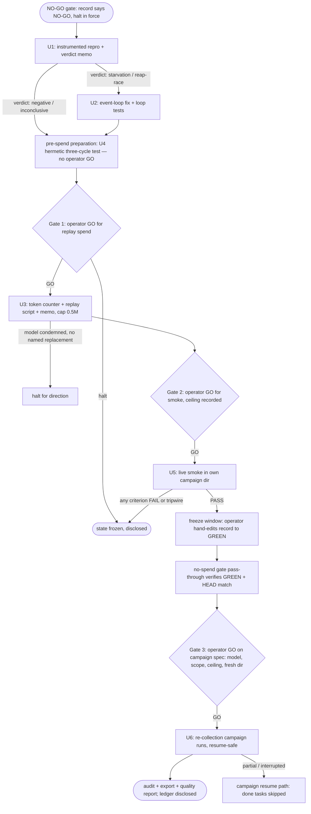

# Re-collection readiness arc: NO-GO gate to campaign GO - Plan

## Goal Capsule

- **Objective:** The campaign launcher no longer refuses for lack of proof: a GREEN gate record matching both repo HEADs exists, earned by a live sandboxed smoke, and a fully specified re-collection campaign has either completed behind the operator's final GO or sits ready-to-run at that gate. Every mechanism the earlier poisoned sweep exposed (log lies, wedge, empty turns) is either fixed-and-proven or characterized-and-disclosed.
- **Means:** Four gated stages in fixed order — done-marker root-cause memo (zero spend), provider characterization memo (~0.5M input-token cap), live smoke earning the GREEN record (~0.7M expected), re-collection campaign (budget set at its gate) (KTD1).
- **Authority:** The operator is the sole spend approver; the standing no-spend halt out-ranks every unit until lifted per gate. The origin plan (docs/plans/2026-09-11-1406-fix-campaign-data-defects-plan.md) remains authoritative for its units' specifications; this plan operationalizes them and adds the new units the arc needs. AGENTS.md governs all engineering conduct.
- **Stop conditions:** Any FAILED pass criterion, tripwire fire, budget-cap abort, or operator halt freezes all spend and returns to the operator with disclosed state (Flow F2).
- **Execution profile:** Zero-spend work first; every spend step behind its own explicit GO with a mechanical cap; all LLM work inside `./run-campaign.sh` sandbox; harness repo (experiments/dataset_collection, own git) commits separately and is never pushed.
- **Tail ownership:** The operator runs the final campaign GO; the executor delivers everything up to and including that gate, plus post-run deliverables if the GO fires.

---

## Product Contract

### Summary

Take the campaign pipeline from today's mechanically-enforced NO-GO to a re-collected SFT corpus: prove the done-marker story with a zero-spend instrumented reproduction, characterize the provider's empty-turn behavior under a hard token cap, earn the first GREEN gate record with a one-task live smoke, then run (or hold ready) the re-collection campaign the evidence supports — the operator approving each spend gate individually.

### Problem Frame

The 2026-09-10/11 sweep produced poisoned data; the user halted collection; the defects were fixed in app and harness and the launcher now refuses spend without a GREEN gate record (GO-NOGO section F). Three evidentiary holes remain before re-collection is defensible: nobody has proven *why* the Done marker never arrives (the escalation synthesis is a designed fallback, not a diagnosis); the provider's empty content/reasoning behavior is characterized only by n=6 small-history samples; and no end-to-end live run has exercised the fixes since they landed. The origin plan deferred re-collection to a follow-up plan (its KD4) — this is that plan, widened to close the three holes first because each hole would otherwise poison the next spend. Two research facts shape the work: no token counter exists anywhere in the harness (caps must be built, not cited), and the harness still carries pre-fix artifacts (a live kill ladder, a stale docstring) the investigation must reconcile.

### Key Decisions

- KD1. Pursue the full arc to re-collection, every spend step individually gated. (session-settled: user-directed — chosen over zero-spend-only, smoke-only, or stopping: the fixes are landed and verified; the arc is the only path that turns them into usable training data) Governs R1, R2, R13, R15.
- KD2. The no-spend halt stands until each gate's explicit GO; caps are mechanical. (session-settled: user-approved — agent proposed per-step gates in the selected track option; user assented) Governs R1, R2.
- KD3. Teacher-model choice is decided at an evidence gate inside the arc; default keeps the current model unless the evidence condemns it. (session-settled: user-approved — chosen over pre-deciding a model switch now) Governs R7, R13.
- KD4. The conditional event-loop fix is in scope only as a proven-verdict contingency. (session-settled: user-approved — chosen over unconditional inclusion or exclusion) Governs R6.
- KD5. The arc ends with the fully specified campaign as a gated unit, not a later plan. (session-settled: user-approved — chosen over stopping at the green gate) Governs R13, R15.

### Actors

- A1. Operator — sole spend approver; owns the halt, the gate GOs, and the final campaign GO; performs the GREEN record hand edit (R11).
- A2. Executor — runs reproductions, writes memos and code, operates the sandbox, discloses all state; never spends without a gate.
- A3. Sandbox/harness — the containment and enforcement layer: `gate_check()` refuses, bulkheads time-box, containment hashes bound blast radius; never an approver.

### Key Flows

- F1. Happy arc: memo verdict → operator GO → capped replay memo → model gate → operator GO → Tier-1 re-check → live smoke passes → freeze-window hand edit → GREEN verified → operator final GO → campaign runs → audit/export/quality report. Covered by U1–U7.
- F2. Halt-and-freeze: any FAILED criterion, tripwire fire, or cap abort stops spend immediately; partial artifacts stay in place; ledger + disclosure go to the operator; nothing resumes without a new GO. Covered by R2, R12 and every unit's failure path.

### Requirements

Spend governance

- R1. No LLM spend occurs before the operator's explicit GO for that specific step; between gates the halt is total.
- R2. Spend caps live in code: the replay unit aborts at its 0.5M input-token cap before the next provider call and persists a partial ledger; the smoke carries a pre-set ceiling recorded with its GO; total pre-campaign spend is capped at ~1.2M input tokens.
- R3. In-sandbox `yolo` auto-approval governs tool steps inside the container only and never substitutes for an arc gate.

Investigation (zero spend)

- R4. The done-marker memo reproduces or refutes each candidate mechanism — child-side hang, idle-callback starvation, reap race — with timestamped evidence across three consecutive start/stop cycles, and records a verdict even when the result is negative.
- R5. The memo reconciles the pre-fix harness artifacts: corrects the stale "no terminal marker arrives" docstring on the harness run-tracking contract, decides the harness kill ladder's disposition (collapse to the loud-halt tripwire if the app terminal path is proven complete; otherwise keep as defense-in-depth with rationale), and reports whether the teardown tripwire fired during reproduction.
- R6. The event-loop fix exists only on a proven starvation or reap-race verdict; a negative or inconclusive verdict closes the unit with a memo reference and the escalation synthesis stands as the designed bounded fallback.

Provider characterization (first spend)

- R7. The replay memo quantifies empty content/reasoning incidence against history size from real captured histories, streaming and non-streaming, with every replayed history scrubbed through the harness's one uniform redaction rule before egress, per-call redaction counts disclosed, and a replay disclosure stating what was re-sent, to which provider, when, and in how many calls.
- R8. If the correlation is not establishable within the cap, the memo says so and the model gate proceeds on tolerate-and-disclose; absent evidence never blocks the arc.

Proof gate (second spend)

- R9. Smoke pass criteria: bounded run's log non-empty with kill/crash disclosure; reasoning present on non-tool-call assistant turns; three clean live start/stop cycles; no simulator give-up; audit + export + round-trip green; containment green; real DB byte-identical; teardown tripwire never fires.
- R10. A hermetic three-cycle integration test exists and is green before the smoke is authorized.
- R11. The GREEN flip is a human-confirmed hand edit of the single gate-record line; both repos stay commit-frozen and tree-clean from smoke start through the flip; the smoke memo records both HEADs and both clean-tree statuses (empty `git status --porcelain`) at smoke start, re-verified current at flip; any mismatch — a moved HEAD or a dirty tree — means re-smoke, never re-record. The flip is verified by a no-spend gate pass-through that reaches the human prompt and aborts there.
- R12. A teardown tripwire fire during any spend step is a FAIL plus halt and fix-at-source — never cleared-and-continued.

Re-collection (final gated execution)

- R13. The campaign spec pins teacher model, request shape, sweep scope (partial task list or all 15), token ceiling, and a fresh campaign dir; the model may be re-pinned only to an exact model+shape named by the replay memo, otherwise the arc halts for direction.
- R14. Per-record dead-log disclosure is added to the dataset card for the new campaign only; frozen corpora and zips are never rewritten.
- R15. Campaign execution runs only on the operator's final GO: resume-safe, per-task containment, post-run audit + export + quality report; a resumed arc re-validates (Tier-1 stages, real-DB leg, model/image confirmation) before older verdicts are honored.

### Success Criteria

- The gate record is GREEN and matches both repo HEADs, earned by a smoke whose export artifact is cited from the record.
- Both memos are committed with their ledgers and disclosures; every provider call outside them is accounted for against a gate GO.
- The re-collection either completed with audit + export + quality report green (or an explicitly disclosed partial state), or is one GO away with the spec pinned.
- No frozen artifact changed; the real DB hash is byte-identical throughout.

### Scope Boundaries

- Rewriting or re-shipping the frozen 2026-09-10/11 corpora and zips — out; annotate-only ever (constraint carried from the origin plan).
- A standalone gate/proof script — out; the existing stage composition plus the record hand edit is the mechanism (Simplify First).
- Model migration beyond an evidence-named re-pin — out; halts for direction instead.
- Harness kill-ladder removal — decided by U1's verdict, not pre-decided here.
- Deferred to follow-up work: anything past a completed re-collection (corpus shipping, training runs, further sweeps).

---

## Planning Contract

### Key Technical Decisions

- KTD1. Arc order is memo → (conditional loop fix) → replay memo → smoke → campaign spec → campaign run, with operator gates between spend stages; the replay memo's budget closes before the smoke is authorized. (session-settled: user-directed — chosen over re-planning step-by-step: mirrors the origin plan's own dependency rules) Governs R1, R13.
- KTD2. The spend sensor instruments the simulator POST path: every call shape counts (initial, in-history repair, clean retry — worst case three per simulator turn), the abort fires before the next POST, and the partial ledger persists beside the memo; usage-summing mirrors the exporter's existing pattern. Calls reporting missing or partial usage consume the cap at the session's observed per-call maximum — fail-closed, because the empty-turn shapes under study are the likeliest to omit usage fields — and the ledger discloses the estimated-versus-measured split. The ledger and memo carry counts, lengths, hashes, and model/shape identifiers only — never raw request bodies, headers, keys, or history excerpts. Governs R2.
- KTD3. An inconclusive reproduction proceeds: negative verdicts close the conditional fix by a qualified memo reference — below the detection threshold for three cycles, with the flake disclaimer stated, not a claim of disproof — and the arc advances; the escalation synthesis is the designed bounded fallback, so a proven-nothing outcome changes documentation, not feasibility. Governs R4, R6.
- KTD4. Smoke-to-flip freeze: the smoke memo records both HEADs and both clean-tree statuses at smoke start; no commit and no working-tree change lands in either repo between smoke start and record flip; flip time re-verifies both; mismatch means re-smoke. The smoke gets its own campaign dir, never reused for re-collection. Governs R11.
- KTD5. The GREEN flip remains a hand edit — no writer code — verified afterwards by a no-spend pass-through of the gate check (banner prints, human prompt reached, abort there proves parse + match without spending). Governs R11.
- KTD6. The reproduction launcher mirrors the dry-run F7 wedge scenario (real app under xvfb, SIGTERM-ignoring block, timestamped event log); instrumentation is DEBUG-gated or removed before merge; existing hermetic batteries remain the unit-level regression base. Governs R4.
- KTD7. A resumed arc re-validates before trusting old verdicts: Tier-1 stages, the real-DB leg, and confirmation that the pinned model and sandbox image still exist as characterized. Governs R15.

### High-Level Technical Design

Budget flow per spend unit: counter increments per provider call → abort fires before the next call at cap → partial ledger + disclosure written → operator decides.

### Implementation Constraints

- All paths below are repo-relative to the outer repo; `experiments/dataset_collection/**` lives in the nested harness repo and commits there separately.
- Atomic writes, flock discipline, single-thread unified loop, `ModelRetry`/`ToolFailed` error split, and no-tool-enumeration-in-prompts all apply as per AGENTS.md.
- The sandbox mounts the repo read-only: app and harness must ship together; the frozen vocabulary conformance tests in both suites guard status-vocabulary skew.

---

## Implementation Units

### Phase 1 — Zero-spend investigation

### U1. Instrumented done-marker reproduction and verdict memo

- **Goal:** A written verdict, backed by a live instrumented reproduction, naming which mechanism(s) stop the Done marker: child-side `tb.wait()` hang, idle-callback starvation, child-watcher reap race — or none of them.
- **Requirements:** R4, R5; cites KTD3, KTD6.
- **Dependencies:** none.
- **Files:** new `docs/investigation/2026-09-11-run-marker-root-cause.md`; temporary DEBUG-gated instrumentation in `src/grc_agent/native_canvas.py` (`_escalate_stop`, `stop_flowgraph`) and `src/grc_agent/exec_monitor.py` (Done handler, `synthesize_terminal_state`); a debug launcher under `playground/` mirroring `experiments/dataset_collection/dryrun.py`'s F7 scenario shape; harness side: `experiments/dataset_collection/collection/contract.py` (docstring correction), `experiments/dataset_collection/collection/runner.py` (ladder disposition per verdict), `experiments/dataset_collection/docs/AUDIT-2026-09-09.md` (addendum).
- **Approach:**
  1. Boot the real app under `xvfb-run -a` via the debug launcher; open a qt_gui graph with a file sink; run bounded and unbounded, stop each; three consecutive cycles.
  2. Log with timestamps: child PID/exit per signal stage, escalation transitions in `_escalate_stop`, `done()` entry and `handle_message` marker sightings, `_tracking`/`_run_epoch`/`synthesize_terminal_state` outcomes per cycle, and whether the harness teardown tripwire (`experiments/dataset_collection/collection/runner.py::_stop_run`) fires.
  3. Starvation probe: enqueue a permanently-ready higher-priority GLib source; separately run a SIGTERM-ignoring graph to force the child-hang path.
  4. Write the verdict memo (existing `docs/investigation/` audit/verify pair is the shape precedent); apply the reconciliation outcomes: corrected harness docstring, ladder disposition (collapse to the loud-halt tripwire or keep as defense-in-depth with rationale), tripwire observation.
- **Execution note:** Instrumentation is removed or DEBUG-gated before merge; the hermetic synthesis and escalation batteries (`tests/test_exec_monitor.py`, `tests/test_run_stop_tools.py`) are the regression guard while it exists.
- **Test scenarios:**
  - Happy path: repro runs three clean cycles end-to-end; memo cites the timestamped log for each claimed mechanism.
  - Edge: natural Done arrives during the grace window (race) — memo records which side won and why.
  - Error path: SIGTERM-ignoring graph forces escalation — synthesis path retains log with disclosure; next cycle clean.
  - Integration: tripwire never fires across all cycles; if it fires, that is a finding (R12 semantics), not a flake.
- **Verification:** Memo committed naming reproduced mechanism(s) or an explicit negative verdict with evidence — negative or inconclusive verdicts are reported as below the detection threshold for three cycles, with an explicit flake disclaimer, never as disproof; reconciliation edits landed in the harness; repo fast gate + harness suite green.

### U2. Event-loop delivery or reap fix (conditional)

- **Goal:** Marker delivery no longer depends on the unproven branch — only if U1 proves idle starvation or a reap race.
- **Requirements:** R6; cites KD4, KTD3.
- **Dependencies:** U1's verdict.
- **Files:** `src/grc_agent/event_loop.py`, `tests/test_event_loop.py` (first dispatch-priority/watcher tests there), possibly `src/grc_agent/exec_monitor.py`.
- **Approach:** Follow U1's evidence: starvation → ensure the unified loop dispatches GLib idle-priority sources; reap race → install a loop-compatible child watcher or reap via the established pattern. Single-thread invariant absolute; no cross-thread marshaling.
- **Test scenarios:**
  - Regression: a permanently-ready higher-priority source does not delay marker delivery beyond one loop iteration (only if starvation proven).
  - Regression: SIGTERM'd child reaped mid-teardown raises nothing into the request path (only if reap race proven).
  - U1's repro scenario passes without instrumentation; full xvfb GUI set green.
- **Verification:** New loop-level tests green; U1 scenario re-run clean; if U1 disproves both branches this unit is closed with a memo reference instead (KTD3) — that is a valid completion, not a skip.

### Phase 2 — Provider characterization (Gate 1 spend)

### U3. Token counter, replay script, and characterization memo

- **Goal:** A written characterization of the provider's empty content/reasoning behavior under the app's exact request shapes, with a mechanical cap honored by code, settling the audit's long-history hypothesis or declaring it unestablishable.
- **Requirements:** R2, R7, R8; cites KTD2.
- **Dependencies:** U1 landed (ordering, not evidence); Gate 1 GO.
- **Files:** `experiments/dataset_collection/simulation/client.py` (usage capture on the POST path); new replay script + test under `experiments/dataset_collection/` (sandbox-invoked); `experiments/dataset_collection/verification/__init__.py` is a read-only dependency — owner of the blob-media restore helper the replay driver must offload; new `docs/investigation/2026-09-11-glm-empty-turn-characterization.md`; harness audit doc addendum.
- **Approach:**
  1. Extend the simulator POST path to return per-call usage; count every call shape — initial, in-history repair, clean retry (worst case three per simulator turn; the vestigial repair-constant naming must not mislead the math). Usage capture is fail-closed: a response with missing or partial usage counts at the session's observed per-call maximum.
  2. Pre-state the condemn threshold before replaying: the minimum empty-turn incidence gap, with its history-length effect, at the achieved sample sizes that would justify re-pinning the teacher model. Then replay 3–5 real histories from the operator-designated campaign dir (checksummed DB copy pattern), streaming and non-streaming; correlate empty-turn incidence with history length; post the simulator's format-constrained body at varying history lengths.
  3. Scrub every replayed history through the harness's one uniform redaction rule before egress; disclose per-call redaction counts and a replay disclosure (what, where, when, call counts).
  4. Abort before the next POST at the 0.5M cap; persist the partial ledger beside the memo; a re-run starts a new counted session and discloses the old calls (no double-count, no silent discard).
- **Execution note:** Sandbox-only spend (`run-campaign.sh shell`); the memo's last section is the model-gate recommendation the campaign spec (U6) consumes.
- **Test scenarios:**
  - Happy path: counter accumulates across call shapes; abort fires before the next POST at cap; ledger written.
  - Edge: history from a redaction-quarantined record replays scrubbed and flagged.
  - Error path: transport failure mid-replay — partial ledger discloses exactly which calls were sent.
  - Integration: the replay driver offloads `_restore_blob_media` (owned by `experiments/dataset_collection/verification/__init__.py`, which runs its own event loop) correctly from its async context — asserted in the replay-driver test.
- **Verification:** Memo committed with incidence rates, sample sizes, correlation verdict (or unestablishable-within-cap statement), and the model recommendation; counter code covered by tests; ledger discloses totals against the cap.

### Phase 3 — Proof gate (Gate 2 spend)

### U4. Hermetic three-cycle start/stop integration test

- **Goal:** The smoke's three-clean-cycles criterion has a zero-spend, always-runnable guardian.
- **Requirements:** R10.
- **Dependencies:** none — zero-spend, no operator GO; must be green before the smoke unit starts (any time up to the Gate 2 GO).
- **Files:** new `tests/test_start_stop_cycles.py` (reusing the `_FakeExecMonitor`/`_make_proxy` seams from `tests/test_run_stop_tools.py`) or an extension there if the coupling is cleaner.
- **Approach:** Three consecutive start → bounded run → stop → assert-clean cycles through the real proxy/monitor seam under the injected clock, asserting: escalation transitions only when shutdown lingers, log retention with disclosure per synthesized terminal, `run_id` advance per cycle, vocabulary conformance throughout, healed tracking before each next start.
- **Test scenarios:**
  - Happy: three cycles, each terminal clean, vocabulary conformant, run_id advances 1-2-3.
  - Edge: cycle 2 stop lingers → escalation fires → cycle 3 still starts clean.
  - Error: vanished process between cycles — healed without blocking the loop (injected clock proves non-blocking).
- **Verification:** New test green in the outer fast gate; no production code change expected (if one proves necessary, that is a finding back to U1's memo).

### U5. Live smoke and GREEN record flip

- **Goal:** One live sandboxed task proves the fixes end-to-end; the operator's hand edit records GREEN with the freeze discipline.
- **Requirements:** R9, R11, R12; cites KTD4, KTD5.
- **Dependencies:** U3's budget closed; U4 green; Tier-1 re-checked (preflight, gates, dryrun, validate-real-db); Gate 2 GO with a recorded ceiling.
- **Files:** `experiments/dataset_collection/sandbox/GO-NOGO.md` (the single record line, edited by hand); `experiments/dataset_collection/docs/AUDIT-2026-09-09.md` (smoke addendum citing the export artifact); a smoke memo recording smoke-start HEADs and pass-criteria evidence; no new code — the smoke composes existing stages.
- **Approach:**
  1. Freeze: record both HEADs and clean-tree status (no uncommitted or untracked files in either repo); no commits and no tree changes until the flip is done.
  2. Run one task via the campaign stage in its own campaign dir; watch all pass criteria live; tripwire fire = FAIL + halt.
  3. On PASS: operator hand-edits the record line to GREEN with the smoke date, smoke-start HEADs, and task id; verify with the no-spend pass-through (banner prints, human prompt reached, abort there).
  4. Unfreeze; commit the memo + record + addendum in the harness repo.
- **Execution note:** Partial or failed smoke artifacts stay in the smoke campaign dir for inspection; they are never reused as re-collection state (KTD4).
- **Test scenarios:**
  - Happy: all R9 criteria observed live; pass-through verifies the flipped record parses, is GREEN, and matches both HEADs.
  - Edge: a commit slips in before the flip → flip-time re-verification catches the mismatch → re-smoke (the record is never edited to match moved HEADs).
  - Error: any criterion FAILs mid-smoke → halt-and-freeze; partial artifacts disclosed; no flip.
- **Verification:** GREEN record matching both HEADs; pass-through evidence captured; smoke addendum cites the export; zero commits inside the freeze window (verifiable from both repos' logs).

### Phase 4 — Re-collection (Gate 3 spend)

### U6. Campaign spec and dataset-card amendment

- **Goal:** A pinned, evidence-linked campaign specification the operator can approve in one read.
- **Requirements:** R13, R14; cites KD3.
- **Dependencies:** U3's model-gate recommendation; U5's GREEN record.
- **Files:** `experiments/dataset_collection/exporter.py` (per-record dead-log disclosure line on the generated card + quality surface), its tests; the spec itself recorded in the harness audit doc (or a short spec doc beside it) — model pin, request shape, sweep scope, token ceiling, fresh campaign dir path.
- **Approach:** Model re-pins only when U3's pre-stated condemn threshold is met and only to the exact model+shape the memo names; otherwise keep the current model under tolerate-and-disclose (KD3). Sweep scope (partial list vs all 15) and ceiling are stated for the operator's single-shot approval; the card amendment lands only in the new campaign's generated surfaces — frozen corpora untouched.
- **Test scenarios:**
  - Happy: card generation includes the per-record dead-log line; existing round-trip and quality gates stay green.
  - Edge: zero dead-log records → the line renders an explicit zero, not silence.
  - Error: spec cites a model the memo never named → spec invalid, halt for direction.
- **Verification:** Spec committed and cited from the gate record's next addendum; card-amendment tests green in the harness suite.

### U7. Campaign execution and post-run deliverables

- **Goal:** The re-collection runs once, behind the final GO, and lands fully audited.
- **Requirements:** R15; cites KTD7.
- **Dependencies:** U6's spec approved (Gate 3 GO); GREEN record current at launch.
- **Files:** campaign dir under `~/grc-campaign-sandbox` (fresh); post-run `audit`, `export` (round-trip), `audit --quality-report`; committed deliverable copies of the quality report + card in the harness repo docs; ledger disclosure against the ceiling.
- **Approach:** Launch through the campaign stage only; resume is safe (done tasks skipped, fixtures recreated per boot) so an interruption costs nothing already spent; per-task containment runs throughout; weeks-later resumption re-validates first (Tier-1 + real-DB leg + model/image confirmation).
- **Test scenarios:**
  - Happy: sweep completes within ceiling; audit + export + round-trip + quality report green; real DB byte-identical.
  - Edge: interrupted mid-sweep → resume skips done tasks; ledger and verdicts reconcile across the gap.
  - Error: containment violation on any task → that task quarantined with reason; sweep halts for the operator.
- **Verification:** Final ledger disclosed (total input tokens vs ceiling); quality report disposition counts committed; GO-NOGO addendum records the campaign outcome; both repos clean and committed.

---

## Verification Contract

| Gate | Command / check | Applies to |
| --- | --- | --- |
| Repo fast gate | `uv run pytest tests/ --ignore=tests/test_integration.py --ignore=tests/test_button_integration.py` | every outer-repo unit |
| Display set | `xvfb-run -a uv run pytest tests/test_chat_sidebar.py tests/test_chat_sidebar_golden.py tests/test_native_canvas.py tests/test_desktop_app.py tests/test_session_persistence_advanced.py tests/test_context_compaction.py` | U1, U2, U4 |
| Harness suite | `uv run pytest experiments/dataset_collection/tests -q` | U1, U3, U6 (harness side) |
| Lint both repos | `uv run ruff check` (outer; harness via its own tree) | every unit |
| Task specs | `uv run python -m experiments.dataset_collection.task_spec --validate` | U6, U7 |
| Sandbox stages | `./run-campaign.sh preflight` / `gates` / `dryrun` / `validate-real-db` — all green before any GO | U5, U7 |
| Gate pass-through | `./run-campaign.sh campaign` reaching the human prompt then aborting (no spend) proves record parse + HEAD match | U5 flip verification |
| Invariant | `sha256sum .grc_agent/chat_sessions.db` = `5738f1482503de02ffb155337d41d883719dc3581430ae742f68391596d33c17` at every unit boundary | all |

---

## Definition of Done

Global:

- Every spend call is attributable to a gate GO and counted by the mechanical sensor; total pre-campaign spend ≤ ~1.2M input tokens with ledgers committed.
- Both memos committed with verdicts; reconciliation edits landed; GREEN record present and matching both HEADs; campaign spec pinned; campaign either completed-and-audited or one GO away.
- All gates in the Verification Contract green at the last unit boundary; both repos committed, trees clean, harness repo never pushed; frozen artifacts and real DB unchanged.
- Cleanup: no DEBUG-gated instrumentation, debug launchers, or dead-end experiment code remains in either tree; temporary repro artifacts are removed or committed as deliberate fixtures.

Per unit:

- U1: verdict memo committed naming mechanisms or an explicit negative; reconciliation edits in the harness; no instrumentation left behind.
- U2 (if triggered): loop-level tests green; U1 scenario re-runs clean without instrumentation. (If not triggered: closed-by-memo-reference recorded in U1's memo — a completion, not a gap.)
- U3: counter + tests green; memo with incidence rates, sample sizes, correlation verdict, model recommendation; ledger within cap.
- U4: three-cycle test green in the fast gate.
- U5: GREEN record verified by pass-through; smoke addendum cites the export; freeze window clean in both git logs.
- U6: spec committed; card amendment tested; model pin traceable to the memo.
- U7: audit + export + round-trip + quality report green; ledger disclosed; outcome recorded in the gate addendum.
