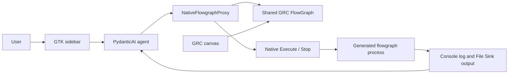

# Technical overview

GRC Agent is a native GTK companion to GNU Radio Companion. PydanticAI owns agent execution, tool dispatch, approvals, and message history. GRC owns block evaluation, graph validation, code generation, and flowgraph execution.

## Application and graph ownership

The desktop UI and agent share the asyncio/GLib event loop installed before UI initialization by `event_loop.install()`. PyGObject's `gi.events` provides the integration on newer systems; older supported systems use `gbulb`.

`NativeFlowgraphProxy` forwards graph access to the active page's in-memory `FlowGraph`. Agent edits therefore affect the same object the canvas draws. GRC starts generated flowgraphs in its native child-process runner; this is distinct from the parent application's UI/agent loop.

## Tool responsibilities

| Tool group | Responsibility |
| --- | --- |
| `inspect_graph` | Semantic topology, parameter values, validation state, and native file identity. |
| `query_knowledge` | Catalog schemas and locally indexed GNU Radio documentation. |
| `generate_python` | Read-only source preview through GRC's generator. |
| `change_graph` | Approved transactional graph edits with native validation and rollback. |
| `grc_interaction` | Native start/stop, run logs, numerical measurements, plots, and canvas images. |
| `save_graph` | Atomic save of the active graph, including untitled graphs. |
| `save_block` | Export an Embedded Python Block into GNU Radio's reusable block library. |
| Filesystem tools | Project-scoped reads and atomic edits; `.grc` reads become structural inspection and direct `.grc` writes are rejected. |
| Shell tools | Approved foreground/background commands within the project, with credential scrubbing and job cleanup. |

The separately selected planner receives a read-only tool subset, including `get_run_log`, plus durable plan writing. The executor receives the saved plan through a system reminder; it does not run an automatic planning stage. Web search/fetch capabilities depend on the configured backend.

## Graph inspection, editing, and saving

`inspect_graph` identifies the live graph using GRC's `grc_file_path`. A null file path means the graph has never been saved; its options-block ID is not proof of a disk file. Inspection removes visual/layout plumbing and default or advanced parameters through native GRC metadata, with explicit omission information.

`change_graph` applies removals, additions, parameter updates, automatic type resolution, state changes, and connections transactionally. GRC evaluates expressions and validates the result. Failed mutations roll back; a failed rollback is reported. Successful agent edits notify the canvas directly. Native validation also checks the final turn, without treating tool-generated image prompts as new user requests.

Graph additions trigger a full layout with separate header and flow bands, per-component rows, and topological ordering. Manual canvas edits are not automatically relaid out. Saving uses GRC serialization, a per-graph lock, and atomic replacement. Untitled graphs are named inside the project directory; existing saved graphs retain their file identity.

## Retrieval

Catalog and documentation retrieval share a local SQLite store with FTS5 lexical search. Optional local EmbeddingGemma/llama.cpp embeddings add vector search; reciprocal-rank fusion combines vector and lexical rankings. The embedding backend is independent of the chat provider.

Results disclose lexical fallback, search mode, and truncation. Lexical results have no fabricated vector distance. Catalog results include native parameter/port definitions and implementation docstrings. The bundled `docs/wiki_gnuradio_org` corpus is runtime knowledge, not development scratch documentation, and remains part of the package.

## Execution evidence

See [GRC interaction](grc-interaction.md) for the modes and capture workflow.

The execution monitor retains console output with run identity, process exit evidence, runtime errors, and truncation state. It binds the native child process after Execute and does not treat unrelated GRC completion messages as that process exiting. Agent-initiated failures return in the current tool call; user-initiated failures can trigger the sidebar's diagnosis flow.

File Sink observations derive representation from the executed graph and bind the output to the run before analysis. Sealing requires observed process exit. File replacement, graph changes, mismatched runs/pages, invalid alignment, and nonfinite samples prevent false verification. Deliberately stopped captures are labeled as potentially partial.

Numerical mode returns measurements to the model and stores its plot in tool metadata for the human. Explicit plot and canvas modes send image content to a vision-capable model. Canvas images establish topology; they do not establish signal correctness. Both live and reloaded transcripts preserve tool images and text.

## Approvals and failure semantics

Graph mutation, native start, and shell execution use PydanticAI deferred approvals. Native stop is ungated. Invalid arguments are rejected before the approval request. Approval cards render the proposed arguments using the same argument-repair rules as validation.

Recoverable argument or graph faults raise `ModelRetry`. Missing capabilities and terminal environment faults raise `ToolFailed`; repeated terminal failures and model-request counts are bounded per turn. Tool results remain data, including content flagged by the prompt-injection detector.

## Persistence and verification

Sessions and plans use local SQLite storage. PydanticAI message serialization preserves structured history and multimodal parts. Compaction retains recoverable transcripts, and cancellation/failure paths preserve completed tool effects and failure evidence.

The default test gate isolates settings, databases, and vector stores and blocks real model requests. Explicit integration tests opt in to network access. Native runtime acceptance drives actual GRC Execute/Stop and compares generated samples against an independent known-good/known-bad signal specification. Scenario tests cover graph-editing workflows separately; a past model result is not a guarantee for another model or task.

Use [AGENTS.md](../AGENTS.md) for architecture constraints and required checks, [the changelog](../CHANGELOG.md) for shipped behavior, and [the backlog](backlog.md) for unfinished work.
